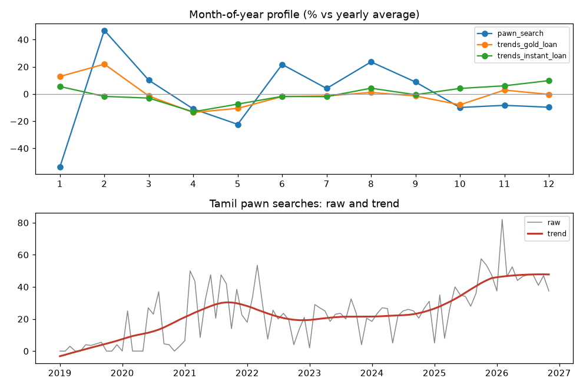
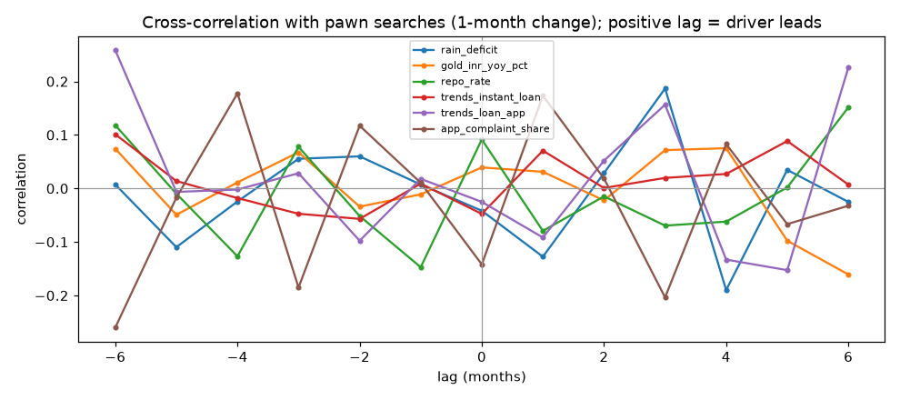

# Phase 4: what the signals say

Generated by `python -m src.analysis.explore` from `data/processed/panel_monthly.csv`
(2019-01 to 2026-11). Numbers refresh when the script reruns.

**Target.** There is no public monthly series of household credit stress by district,
so the yardstick is Google searches in Tamil for pawning jewellery (`நகை அடகு`,
`நகை கடன்`), called *pawn searches* below. People search for this when they need cash
against gold, so it is the closest open proxy for distress borrowing in Tamil Nadu.
Gold auction counts would be the better target, but the lender only posts about
7 months of notices, which is too short for these tests (see README).

## 1. Seasonality

| series | seasonal_strength | peak_month | trough_month | peak_vs_avg_pct |
|---|---|---|---|---|
| pawn_search | 0.52 | 2 | 1 | 46.8 |
| trends_gold_loan | 0.1 | 2 | 4 | 22.0 |
| trends_instant_loan | 0.15 | 12 | 4 | 9.8 |

*Seasonal strength* runs 0 to 1 (STL decomposition); above about 0.4 the calendar
explains a lot of the movement, so the index must compare each month with the same
month in other years, not with last month.

## 2. Lead-lag and Granger causality

| driver | transform | n | best_lag | corr_at_best | corr_lag0 | granger_best_lag | granger_p |
|---|---|---|---|---|---|---|---|
| rain_deficit | level | 93 | 4 | -0.19 | -0.04 | 4 | 0.121 |
| gold_inr_yoy_pct | 1-month change | 81 | 6 | -0.16 | 0.04 | 6 | 0.525 |
| repo_rate | 1-month change | 94 | 6 | 0.15 | 0.09 | 6 | 0.103 |
| trends_instant_loan | level | 94 | -6 | 0.1 | -0.05 | 1 | 0.59 |
| trends_loan_app | 1-month change | 94 | -6 | 0.26 | -0.03 | 5 | 0.126 |
| app_complaint_share | level | 45 | -6 | -0.26 | -0.14 | 1 | 0.362 |

How to read it: `best_lag` > 0 means the driver moves that many months **before**
pawn searches. `granger_p` < 0.05 means past values of the driver improve a forecast
of pawn searches beyond what pawn searches' own past gives. Series are made
stationary first (`transform`). Granger causality is about forecasting, not proof
of cause. The lowest p-value across lags 1-6 is shown, which flatters
results a little (six tries), so treat p between 0.01 and 0.05 as a hint.

Drivers with Granger p < 0.05: none at the 5% level.

## 3. Known stress periods

Mean z-score inside each window (0 = normal, +1 = one standard deviation above
normal). For district episodes, `z_rain_deficit` uses that district's own rainfall.

| episode | months | where | context | z_pawn_search | z_trends_gold_loan | z_trends_instant_loan | z_rain_deficit | z_gold_inr_yoy_pct |
|---|---|---|---|---|---|---|---|---|
| COVID lockdown | 2020-04..2020-06 | all | income stop, gold loan rush | -0.84 | -0.66 | -1.3 | 0.7 | 0.81 |
| Delta wave | 2021-04..2021-06 | all | second lockdown in TN | 0.32 | -0.39 | -1.18 | -0.01 | -1.03 |
| RBI tightening | 2022-05..2023-02 | all | repo 4.0% to 6.5% | -0.41 | -0.38 | -0.78 | 0.03 | -0.88 |
| Cyclone Michaung floods | 2023-12..2024-01 | Chennai | Chennai flooding | -0.24 | -0.25 | 1.1 | -1.04 | -0.65 |
| Cyclone Fengal floods | 2024-12..2025-01 | Villupuram | Villupuram flooding | -0.33 | 0.28 | 0.55 | -0.78 | 0.5 |

Reading the episodes: pawn searches **fell** during the COVID lockdowns, when
branches were shut and Trends' relative scale was swamped by health searches. So
search signals can miss stress when access itself stops. The flood episodes show the
district's rainfall as wetter than normal (negative deficit), so the rain signal must
treat extreme excess rain as stress too, not only drought.

## What this means for the index (phase 5)

- Score rainfall on both tails: deficit and flood-level excess.
- Use year-on-year or same-month comparisons for seasonal series.
- Weight drivers by how well they lead, but keep the weights simple and visible,
  because the history is short and the target is a proxy.
- Treat the auction counts as a confirming signal once a year of history builds up.
